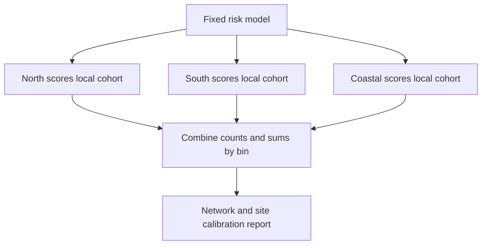

# Federated Risk Model Evaluation

**A Research prototype for combining clinic-level validation statistics from a shared chronic-disease risk model.**

A shared model can have acceptable average performance across a network and still underestimate risk at one clinic. This project demonstrates how a simulated clinic can score its own evaluation patients, compute a small set of summary statistics, and send those statistics for a network-level calibration report. The report preserves clinic-level results alongside the network result so differences remain visible.

This is the evaluation companion to the **Federated Chronic Care Benchmark**, which compares training strategies. Here, one fixed model is evaluated at North, South, and Coastal. The model predicts a first recorded type 2 diabetes diagnosis within 365 days among adults with recorded prediabetes. All records are synthetic.

## What the toolkit evaluates

| Output | Question it answers |
|---|---|
| Clinic calibration summary | Does the clinic's mean predicted probability agree with its observed event rate? |
| Network calibration summary | Does the mean predicted probability agree with the observed event rate across participating patients? |
| Calibration by score range | Where do observed frequencies and average predictions diverge across probability bins? |
| Brier score | How large is the average squared probability error at each clinic and across the network? |
| Site payloads | What exact fields did each simulated evaluator provide to the aggregator? |

## Quick start

Use Python 3.11 or 3.12. Run from the repository root.

```bash
python -m venv .venv
source .venv/bin/activate
python -m pip install -r requirements.txt
python evaluate.py
python -m unittest discover -s tests -v
```

The demo generates its own synthetic FHIR R4 records and writes `build/evaluation.json`. See the [technical user guide](USER-GUIDE.md) for Windows setup, the report schema, and reproducibility instructions.

## Study design

1. Generate synthetic FHIR records and extract a prediabetes cohort using the same fixture and eligibility rules as the companion projects.
2. Fit one logistic regression model and its preprocessing using North and South records indexed in 2022. The predictors are age, latest eligible A1c, and A1c change.
3. Score three groups of synthetic patients indexed in 2024. North and South provide later-period evaluation at the training sites. Coastal provides evaluation at a site excluded from model fitting.
4. At each site, summarize the scores and completed outcomes within a common set of probability bins.
5. Add the summaries bin by bin. Derive network rates and errors from the combined counts and sums.

The model is trained on pooled synthetic data in this demo. The federated part is the design of the evaluation exchange after the model is fixed.



## Default results

Calibration gap is mean predicted probability minus observed outcome frequency. Negative values indicate average underprediction in the evaluation cohort.

| Cohort | Patients | Calibration gap | Brier score |
|---|---:|---:|---:|
| North, later period | 426 | −1.16 percentage points | 0.1258 |
| South, later period | 421 | −0.45 percentage points | 0.1167 |
| Coastal, held-out clinic | 831 | −9.69 percentage points | 0.1829 |
| Combined network | 1,678 | −5.21 percentage points | 0.1518 |

The network result represents the combined patients. Coastal contributes nearly half the evaluation population and has a larger gap than the network average. Its simulated population has a higher probability of the recorded outcome and more missing historical A1c values. The comparison combines differences in site and time.

See the [complete example report](docs/sample-evaluation.json) for counts, observed rates, predicted rates, score bins, and the site payloads.

## Sample use cases

### 1. Find a calibration issue hidden by the network average

Open `network.calibration_gap` and compare it with `sites.coastal.calibration_gap`. Review the average score and observed outcome rate at Coastal, then inspect its populated score bins. The network average summarizes the combined cohort. The local report shows where the model could warrant further validation.

### 2. Verify the aggregate calculation

Open `site_payloads` and sum the patient counts and event counts from every site and bin. Dividing the event total by the patient total gives `network.observed_rate`. Repeat with the squared error totals to reproduce the network Brier score. The denominator weights each patient equally, even when clinic sizes differ.

### 3. Inspect exactly what a site sends

Each site sends four fields per common score bin: patient count, outcome count, score sum, and squared error sum. Inspect the JSON payload and the `site_summary()` function. The aggregation step consumes those fields and does not require encounter identifiers or individual score rows. A bin containing one patient can still expose that patient's outcome and score, so the demo payload should never be used to share real patient data.

### 4. Check whether a score range behaves differently across sites

Compare a populated interval in the network report with the same interval under individual clinics. Read the clinic denominator and the difference between average score and event rate before interpreting any apparent mismatch. The sample has no confidence intervals or minimum-bin reporting policy.

### 5. Reproduce the example and compare simulation seeds

Run `python evaluate.py --seed 42 --out build/seed-42.json` and compare it with the bundled report. Repeat with `--seed 123` and inspect how site counts and calibration gaps change. This explores synthetic sampling variability under a fixed data-generating design.

## Scope

This is a single-process simulation. The code fits the model centrally and simulates site scoring with synthetic data. It has no network transport, secure aggregation, differential privacy, or suppression of small cells. Exact AUROC and average precision are outside the report because the payload does not include individual score rankings. The evaluated outcomes are already available at the end of follow-up. This prototype has no established clinical validity.

## Project files

| Path | Purpose |
|---|---|
| [Technical user guide](USER-GUIDE.md) | Setup, CLI options, JSON contract, and verification |
| [Evaluator](evaluate.py) | Model fitting, simulated site scoring, aggregation, and reporting |
| [Study fixture](study_fixture.py) | Synthetic FHIR resources and cohort extraction |
| [Sample evaluation](docs/sample-evaluation.json) | Default site payloads and combined report |
| [Tests](tests/test_evaluation.py) | Pooled parity, score validation, and synthetic network accounting |
| [GitHub publishing fields](docs/github-publishing.md) | Name, description, topics, and first commit |
